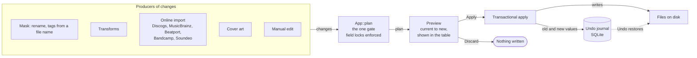
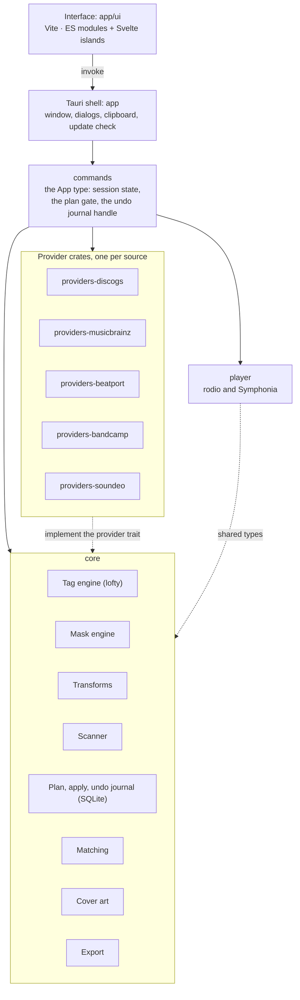

# TagRex architecture

This document fixes the module boundaries and the reasoning behind them. It was
written before any code existed and is kept current as the code catches up with
it: what follows is the shape of the program as it stands, with the reasoning
that produced it. It is the yardstick for design decisions and the first thing a
contributor should read. Per-change history is in `CHANGELOG.md`, not here.

## The one idea everything follows from

Every operation in a tag editor — renaming from a mask, parsing tags out of a
filename, importing a Discogs release, running a regex replace — is the same
thing: a **plan of changes** applied to a set of files. The defining quality of
the batch taggers this project exists to replace — the one thing they all get
right — is that the user always sees the plan rendered as a "current → new"
preview *before* anything touches disk.

Therefore the heart of TagRex is a single transactional pipeline:



Everything else — masks, transforms, online providers — is just a producer of
plans. No module writes tags or renames files directly; all writes go through
the pipeline. This is an invariant, not a preference.

## Module map

How the pieces depend on each other (an arrow means "uses"):



### Core (single Rust workspace member, always compiled)

| Module | Responsibility | Notes |
| --- | --- | --- |
| Tag engine | Read/write ID3v2.3/2.4, ID3v1, APE, Vorbis Comments, MP4 atoms | Backed by [lofty](https://github.com/Serial-ATA/lofty-rs); no hand-written parsers. Writes go through the concrete tag type, so frames the app has no field for — cue points, ratings, ReplayGain — survive a round-trip. A file can carry several blocks; which one is read and written is reported, and tags can be converted from one kind to another |
| Scanner and table model | Async directory scan, virtualized list, multi-select | Must stay responsive at 50k+ files |
| Mask engine | One grammar, two directions: generate (tags → filename) and parse (filename → tags), plus a function library over both | A single implementation for both directions is mandatory — divergent placeholder behavior between rename and import is the worst class of bug this tool can have. The one deliberate exception: **a mask that calls a function is render-only**, because substitution is invertible and `$upper` is not |
| Transform pipeline | Case conversion, find/replace, regex, trimming | Composable chain of steps over fields; used by masks, manual edits, and provider post-processing (e.g. stripping Discogs `Artist (3)` disambiguation) |
| Transaction pipeline | Compile plans, render previews, apply, journal | See "Undo journal" below. Every plan the backend builds returns through **one gate** (`App::plan`), which is where field locks are enforced — an operation written later is covered without its author having to know the gate exists, and the preview cannot promise a change that apply will not make |
| Matching | Score a release candidate against the files in hand | Content-based, plus exact ISRC matching; shared by every provider so a new source inherits it |
| Cover art | Fetch, embed, export, resize, `folder.jpg` | A cover change is a change in the plan like any other, so it previews and undoes like one |
| Export | Playlists, CSV, HTML, XML, mask-based reports | Read-only by construction: writes go into the opened folder, never into the audio files |

### Plugins (module boundary now, dynamic loading maybe later)

"Plugin" initially means a **trait boundary in a separate crate**, not dynamic
loading. Rust dynamic plugins (stable ABI, `dlopen`) are pain, and a WASM
runtime is over-engineering at this stage. All providers compile into the
binary but live in isolated crates behind a common trait:

```rust
// Sketch, not final. Lives in core; providers implement it in their own crates.
trait MetadataProvider {
    fn search(&self, query: &SearchQuery) -> Result<Vec<ReleaseCandidate>>;
    fn fetch_release(&self, id: &ReleaseId) -> Result<Release>;
    fn field_mapping(&self) -> &FieldMapping;
}
```

Why this boundary matters: metadata sources die. Music stores have closed their
public APIs, and a tagger with the integration wired into its core loses the
feature outright. With providers as
isolated crates, a dead API kills one crate — the core is untouched, and the
community can add or fix sources through ordinary pull requests independent of
the core release cycle.

Planned plugin families:

- **Metadata sources.** Discogs first (personal user token, 60 req/min is
  plenty for tagging), MusicBrainz second (no token, better for non-electronic
  music), Beatport third (digital electronic releases, where it carries the
  catalogue, key and BPM the others do not). Each is its own workspace member
  behind the trait; adding one touches no core code, which is the whole point of
  the boundary. Others can follow as contributions.
- **Cover sources.** Fetch, embed, export.
- **Exporters.** Playlists, CSV, text reports.

### Deferred (deliberately out of scope for now)

- **Audio fingerprinting (AcoustID).** That is the territory of the
  automation-first taggers; the first versions prioritize manual control over
  automagic. The Chromaprint objection is gone — a pure-Rust implementation
  exists — so it was measured instead (#60): on 291 files of a club-music
  collection AcoustID named about 30% correctly, 50–90% of CD-era mainstream
  but 3–10% of the untagged rips, vinyl and masters a fingerprint lookup is for,
  and a few wrong answers came back at near-certain scores. Deferred on those
  numbers, to be re-measured rather than re-argued.
- **ReplayGain.** Audio analysis, not metadata editing. Different world.
- **Scripting / actions**, as the established taggers offer them. This is the
  one on this list that has largely happened, and along the predicted line: the
  transform pipeline was designed as a composable chain precisely so that
  scripting would become *serialization of chains into saved presets* rather
  than a new subsystem, and it did — chains are saved as named action groups and
  re-run as one plan. The mask grammar grew the other half, a function language
  over the placeholders. What is still deferred is a general scripting language
  with control flow and variables, and the case for it is weaker now.

**No longer deferred** (kept here because the reasoning is what the list is
for): the **duplicate finder** is a mode of its own, and the **exotic formats**
turned out to be as cheap as predicted — APE, WavPack, Musepack, Monkey's Audio,
Speex and the rest are read and written.

## Undo journal

The one place where extra complexity is bought up front. The journal must:

- persist across application restarts (SQLite file next to the config);
- record both tag writes (old value → new value per field) and renames
  (old path → new path);
- allow rollback of a whole batch as a unit.

Rationale: "renamed 8,000 files, closed the app, realized in the morning the
mask was wrong" is a real scenario, and it is exactly where every existing
editor fails.

Artwork snapshots share immutable BLOBs across cover and block rows. Hash and
length narrow the lookup; exact bytes decide identity. Removing a batch collects
only unreferenced image BLOBs inside the same transaction. Existing inline
snapshots remain readable. New pooled rows carry an upgrade sentinel in the
legacy data column: older binaries fail closed rather than interpreting an
image reference as empty artwork. Undoing a pooled batch requires the new
reader; reverting source code alone is not a transparent journal downgrade.
Incomplete automatic rollback retains its interrupted record even if updating
execution facts also fails. History reads headers/source paths without loading
tag or image snapshots; actual Undo loads the selected batch.

## Native work and snapshot ownership

Session IPC acquires an asynchronous queue before entering the blocking pool.
The shared session mutex is acquired there, never on the UI event thread or
while occupying an async runtime worker. Apply cancellation uses independent
atomic state and bypasses this queue. Providers have persistent queues per
source, preserving each source's throttle without serializing unrelated sites.
Image downloads do not hold the session lock; confined publication rechecks
the library generation after download. Network preferences are adopted at the
next source job and saving them does not wait for in-flight HTTP.

Display and preview reads share a bounded metadata cache, checked against
nanosecond modification time/length and Unix file identity/change time. Failed
or concurrently changing reads are not cached. Settings and write/Undo attempts
invalidate snapshots. Executor freshness validation always reads disk. Custom
columns derive from one per-file snapshot in one batch request; non-topology
Apply/known Undo refresh only affected rows, with a full scan for moves, unknown
history or failed scoped readback.

Artwork bytes use immutable shared ownership inside native plans. Wire plans
intern base64 assets and reference them from per-file cover metadata; the UI
hydrates shared strings and compacts outgoing plans. MIME/type/description and
image ordering remain per cover. The JSON format accepts older inline images;
internal Rust constructors use shared buffers. These boundaries preserve exact
Apply/Undo bytes while avoiding copies for every selected file.

The UI binds artwork responses/actions to selection and content revisions.
Hidden Editor panels do not rebuild controls or request cover reads. An
unchanged subject retains its draft and input nodes. Automatic transformations
and mask previews allow one active request and one newest queued request;
stale results never publish. Filtering yields during match derivation and
caches normalized text, while final grouping/model publication remains
synchronous. Frame-budget claims still require physical-display profiling.

## Tech stack

- **Core:** Rust. Batch operations over tens of thousands of files are the hot
  path; native speed is not optional.
- **Tag I/O:** lofty. Writing ID3/Vorbis/MP4 parsers by hand is years of work
  already done elsewhere.
- **Shell:** Tauri. One codebase for Windows, macOS (including Apple Silicon),
  and Linux; small binaries; the Rust core runs in-process.
- **Frontend:** Vite compiles the Svelte 5 view in `app/ui/components/App.svelte`
  into `app/dist`. Workspace, utility overlays and settings use locally owned
  shadcn-svelte controls in `app/ui/lib/components/ui`; `components.json` records
  the official registry and aliases. Tailwind utilities and `shadcn.css` map the
  component palette to the existing TagRex light/dark colour tokens, while
  `workbench.css` supplies the compact pill controls and responsive layout.
  `entry.js` mounts the complete view synchronously before importing the existing
  file/tag/provider workflow controllers. Stable IDs and native input/select
  properties remain their interface; generated editor fields and provider actions
  are created through the mounted component factory before handlers attach.
  `runtime-controls.ts` enhances native checkbox/select proxies without
  replacing focused controller nodes. Gesture canvases and artwork tiles retain their specialised
  hit areas. PaneForge is available for later resizable workspace work.
  `npm run build` precedes direct Cargo builds; the Tauri CLI and local debug
  launcher run it automatically. Browser integration tests cover artwork and
  production editor workflows, including settings and narrow layouts.
  Linux WebKitGTK 2.54 uses GPU TextureMapper with whole-frame compositing to
  avoid a fade-end flash in the new Skia compositor. `webkit_compositor.rs`
  confines the workaround to that series and recreates the initial page once
  so the native preferences take effect. `tests/ui/native-rendering.py`
  captures displayed pixels and trusted wheel input for image and dialog fades;
  rerun it before removing the workaround after a WebKit upgrade.
- **Audio:** rodio over symphonia, for the preview player. Decoding earns its
  place twice: playback, and the loudness envelope the seek bar draws. Analysis
  beyond that — ReplayGain — is still out of scope.

## Frontend compatibility boundary

The current view keeps its controller-facing roots mounted for the lifetime of
one window. Keep their IDs stable and do not put settings/menu roots behind a
conditional block without moving surface registration into that lifecycle.
Bits owns surface presence and focus; controllers retain their original nodes,
listeners and logical open state. Closing pixels can outlive logical closure by
140 ms, so action routing must read the `hidden` property, not the attribute.

| Adapter | Instance properties it owns | Cleanup / constraint |
| --- | --- | --- |
| Controller surfaces | `hidden` | Restored on destroy; the attribute is delayed only for exit motion. |
| Controller popovers | `innerHTML`, `appendChild`, `append`, `prepend` | Redirected into the content host and restored on destroy. Do not call other child-mutating APIs on these roots without extending the bridge. |
| Component factory | `className` | Element lifetime; the component must render one stable native root. Controllers own its content, so no managed child snippets or conditional roots. |
| Select proxy | `value`, `selectedIndex`, `disabled`, `hidden`, `focus`, label targets | Restored on unmount. The native node remains the controller API; the themed trigger owns user interaction. |
| Checkbox/slider proxy | Native state properties, `focus`, label targets | Restored on unmount; silent property writes remain silent and user actions emit the native event sequence once. |

These are instance patches, never prototype patches. Add only a contract a
controller actually uses, test it at the user-action boundary and restore prior
descriptors on disposal. Removed-subtree cleanup is batched and must preserve
same-turn reparenting. Runtime diagnostics must not add wheel loggers: the
startup wheel registration is a separate native WebKit requirement.

The virtualised table remains a custom model-backed renderer inside the shadcn
table shell. Its row/cell contract is documented next to `buildTrackRow`.
Spreadsheet navigation consumes that model; batch paste/fill uses one validated
preview and the existing Apply/Undo gate. A client operation label must not
replace backend plan descriptions stored in the journal.

Tabs currently bridge the legacy active classes and Bits state. Keep those
changes paired until a future explicit tab API can become their single owner.
Per-row component mounts and observers are a profiling target, not evidence of
a performance regression by themselves.

## Implementation order

Steps 1–4 are done and shipped; the order is kept because it is the argument for
why the parts were built in that sequence, and it held.

1. ~~Core without any network: scanner → table → masks → preview → apply →
   undo. Formats: MP3, FLAC, M4A.~~ This alone was already a usable tool — a
   full-featured batch tagger minus the online lookups, which is what the first
   releases were.
2. ~~`MetadataProvider` trait + Discogs provider (personal token).~~
3. ~~MusicBrainz provider.~~
4. ~~Covers and exporters.~~
5. Revisit the deferred list — in progress: the duplicate finder and the extra
   formats came off it, scripting arrived as chains and mask functions, and
   AcoustID was measured and stays deferred on the numbers (#60), and
   ReplayGain is still where it was.

## Prior art and positioning

Described as classes of tool rather than by name, because the point is the gap
between them, not a comparison against any one product.

- **The established Windows batch taggers** — the reference UX for masks,
  preview and bulk edits, and the standard TagRex is held to. Their limitation
  is the platform: no macOS or Linux build, or a paid and partial port.
- **The long-lived cross-platform desktop taggers** — capable and portable, but
  built on ageing toolkits, and the interface shows it.
- **The automation-first, fingerprint-driven taggers** — excellent at
  identifying a file with no usable tags at all, weak at manual batch surgery
  on files whose tags are merely wrong.
- **The Linux-native clones of the Windows tools** — the right model, one
  platform.

TagRex's position is the intersection nothing occupies: the manual precision of
the first class, on every desktop platform, with a modern interface. It is not
an automation tool, and it does not try to be one.
