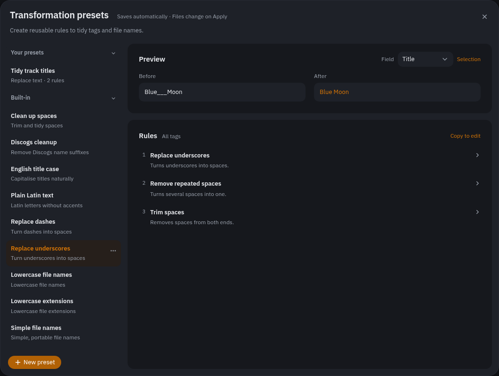
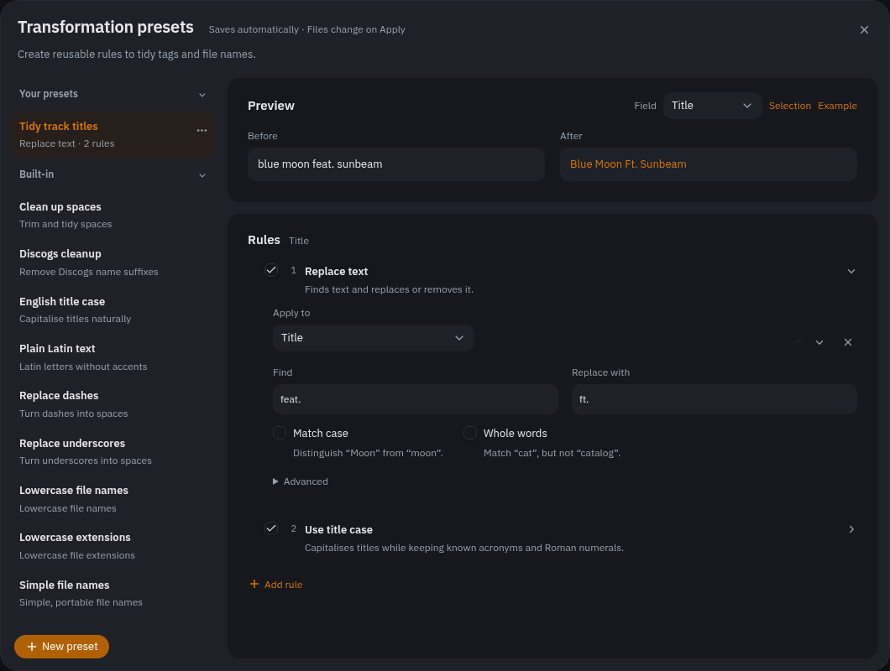

# GENERATOR

Bulk cleanup. Three blocks that share the panel: a chain of text **transforms**,
**track numbering**, and a **vinyl side** splitter. All three stage a preview.

## Transform

Transforms come as **presets**: named, ordered chains of rules. You make and
change them in the preset editor; everywhere else you only tick them.

**The ticked presets run as part of each job.** Behind the wand button in the
toolbar is a checklist of every preset. What is ticked runs by itself when you
import a release, read tags out of file names, or preview a rename — cleanup as
part of the job, not a second step. Each job keeps its own ticked set, and takes
only the rules aimed at what it produces:

| Job | Its own set | Takes the rules on |
| --- | --- | --- |
| Importing a release (ONLINE) | Import | tags |
| FROM NAME, FROM TEXT | From name and text | tags |
| RENAMER and its mask builder | Renaming | the file name and extension |
| GENERATOR | GENERATOR | everything |

So title case ticked to tidy names read out of files does not run on releases
imported from a source, where the values are already right, and a file-name
preset ticked for renaming never touches tags. The checklist shows the set of
the job in front of you; a preset with nothing for that job reads dimmed and
can't be ticked there. The wand button carries a dot while any ticked rule
applies to the current job.

In GENERATOR the checklist sits in the panel, and **Preview changes** runs every
ticked preset over the selection — or over a staged plan, revising it rather
than adding a second one.

### Scope — what the rules act on

**Apply to** decides what the chain sees:

| Scope | Acts on |
| --- | --- |
| All tag fields | Every text field the file carries |
| A single field | Artist, Title, Album, Album Artist, Genre, Comment or Key alone |
| File name | The file name's stem — the extension is untouched |
| File extension | The extension alone — the stem is untouched |

The two name scopes produce a rename plan; the tag scopes produce an edit. Either
way it applies and undoes through the normal path.

`File extension` refuses a result containing a separator or a dot — that would
move the file or change how many extensions the name has — and skips a file with
no extension rather than giving it one.

### Rule kinds

- **Find and replace** — literal text, with labelled **Match case** and **Whole
  words** options. **Advanced → Pattern matching** enables regular expressions.
  Whole words stops a `Dj` → `DJ` rule from mangling `Djibouti`.
- **Change case** — Title, lower, UPPER or Sentence. Title case keeps known
  acronyms and roman numerals intact, so `DJ` doesn't become `Dj` and
  `Symphony III` doesn't become `Symphony Iii`. **Keep small words lowercase**
  leaves articles, short prepositions and conjunctions in lower case inside a
  title, `Lord of the Rings` rather than `Lord Of The Rings`, unless one starts
  or ends the title or a part of it (after a spaced dash, a colon or a slash,
  or inside brackets): `Lord of the Rings - The Return of the King`. Pick the
  list by language (English, German, Spanish, French or Italian) and edit the
  words as text; nothing guesses the language of a value. Off by default.
- **Remove accents** — strips accents off Latin letters: `Björk` → `Bjork`.
- **Use Latin letters** — maps a whole non-Latin script onto Latin:
  `Пётр` → `Pyotr`, `Ελλάδα` → `Ellada`. Cyrillic and Greek. This is a different
  job from removing diacritics, and Latin text passes through untouched.
- **Use Cyrillic letters** — the reverse, for tags that arrived already
  romanized. Reversing a romanization is guesswork, so it is built to be wrong
  as rarely as possible: longest run first (`shch` → щ before `sh` → ш), and a
  word containing a letter with no Cyrillic reading is left in Latin entirely,
  which is what keeps `Jazz` and `The` from becoming `Jазз` and `Тхе`. What the
  forward direction discarded stays discarded: `ъ`/`ь` romanize to nothing, and
  `й`/`ы` both come back as `й`.
- **Musical key format** — converts a musical key between musical, Camelot and
  Open Key notation. Best pointed at the Key field; unrecognized values are left alone.

### The preset editor

**Edit presets…** opens it, and the › at the end of a preset's row in the
checklist opens it on that preset. Your presets are listed first, the shipped
ones below them.

- **New preset** starts an empty preset. **Add rule** opens a short chooser
  explaining each rule type. Click a rule to expand its editor directly below
  it; only one editor is open at a time.
- Right-click a preset, or open its **…** menu, to **Rename**, **Copy** or
  **Delete** it. Rename in the sidebar: Enter confirms, Escape cancels. Deleting
  a personal preset offers a brief **Undo** action.
- Built-ins remain read-only. Expand their rules to inspect them, then use
  **Copy to edit** to make your own version. The original stays unchanged.
- Personal rules have enable checkboxes. A disabled rule stays in the chain but
  contributes nothing. Drag a grip to change the order, or use **Move up** and
  **Move down** inside the expanded editor.
- The pinned **Before / After** preview stays visible while you scroll the
  rules. Choose **Field** to try the rules on a particular tag, file name or
  extension. Type your own example, or use **Selection** when a file is selected.
  Rules for unrelated fields are excluded from that field's sample.
- Shared targets appear once beside **Rules**; mixed targets appear beside
  their individual rules. Pattern errors appear beside the Find field.
- Preset edits save when you switch presets, close the editor or quit.
  Trying a sample never writes your audio files: review the main change plan
  and use **Apply** to write changes.

Presets run in list order as a single plan, each seeing what the previous one
did — so one that lower-cases the file name and one that rewrites the extension
compose into one rename instead of the second discarding the first.

### The shipped presets

| Preset | Scope | What it does |
| --- | --- | --- |
| Clean up spaces | all tags | Collapse runs of whitespace and trim the ends |
| Discogs cleanup | all tags; artists | Drop the numeric disambiguator: `Sunbeam (2)` → `Sunbeam`; on the artist and album artist, also the name-variation asterisk a release page shows: `NBG*` → `NBG` |
| English title case | all tags | Title-case, keeping known acronyms and roman numerals |
| Plain Latin text | all tags | Romanize non-Latin scripts, then strip leftover accents |
| Replace dashes | all tags | Dashes to spaces, then collapse the gaps that leaves |
| Replace underscores | all tags | Underscores to spaces, then collapse the gaps that leaves |
| Lowercase file names | file name | Lower-case the stem, extension untouched |
| Lowercase extensions | file extension | `.FLAC` → `.flac` |
| Simple file names | file name | Plain ASCII, no spaces — a name that survives any server |

Every one of these is a chain you could have built by hand; none of them needs a
rule kind that isn't in the list above.

## Number tracks

Fills track numbers across the selected files **in table order** — so sort the
table the way you want them numbered first.

- **Start at** — the first number. Usually 1.
- **Disc #** — also write a disc number; leave blank to skip.
- **track total** — also write the count of numbered files to every file.
- **restart per group** — with grouping on, start over at each group. This is how
  you number a multi-disc set grouped by folder in one pass.
- **keep vinyl sides** — leave non-numeric positions like `A1` and `B2` alone
  instead of renumbering them. On by default.

## Vinyl sides

**Split side → disc** turns a vinyl position into a plain track number plus a
disc number: side A → disc 1, B → disc 2, and so on. `A1` becomes disc 1,
track 1; `B2` becomes disc 2, track 2. The reverse spelling (`1A`) is understood
too.

This exists because a side letter cannot live in an integer track-number tag.
Once split, the side is recoverable for display and for renaming through the
`%side%` [mask placeholder](masks.md#side--vinyl-sides).

Only rows that actually carry a side letter change.
